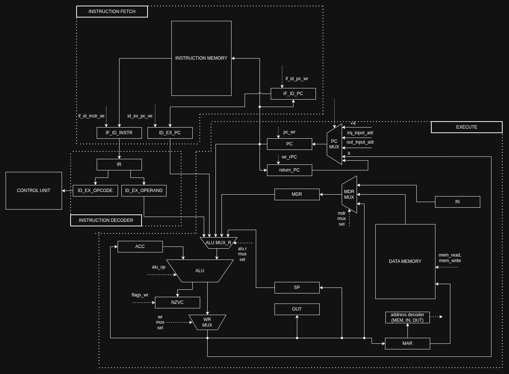
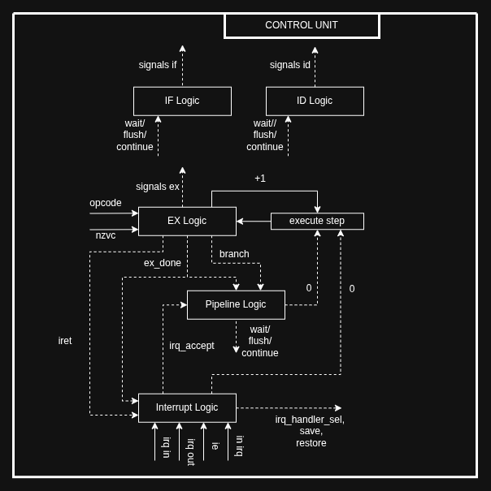

# Лабораторная работа №4. Эксперимент

- **Студент:** Гунько Евгений Алексеевич P3210
- **Вариант:** `lisp | acc | harv | hw | trap | mem | cstr | pipeline | alg1`
    - `lisp` — язык S-выражений, поддержка рекурсивных функций и выражений в качестве аргументов.
    - `acc` — аккумуляторная система команд.
    - `harv` — раздельная память инструкций и данных.
    - `hw` — жёсткая логика управления, без памяти микрокоманд.
    - `trap` — ввод по расписанию тактов с обработчиками прерываний.
    - `mem` — отображение регистров устройств на память данных.
    - `cstr` — строки с нулевым терминатором.
    - `pipeline` — конвейер IF / ID / EX.
    - `alg1` — алгоритмы `is_prime` и `format_string`.

# Язык Lisp

Программа представляет собой последовательность S-выражений в префиксной записи. Оператор или имя формы находится в начале списка; аргументы располагаются после него. Поддерживаются целочисленные и строковые литералы, переменные, арифметика, сравнения, управляющие конструкции и функции. Комментарии начинаются с `#`.

## Синтаксис

Упрощённая грамматика в форме EBNF (тело конструкции обозначается списком выражений):

```ebnf
program       = { expression } ;
expression    = integer | identifier | string | form ;
form          = "(" binary_op expression expression ")"
              | "(set" identifier expression ")"
              | "(if" expression body [ "(else" body ")" ] ")"
              | "(while" expression body ")"
              | "(repeat" expression body ")"
              | "(defunc" identifier parameters body ")"
              | "(funcall" identifier arguments ")"
              | "(input)" | "(input [" integer "])"
              | "(print_char" expression ")"
              | "(print_number" expression ")"
              | "(print_string" expression ")"
              | "(array" integer ")" | "(string" integer ")"
              | "(aget" expression expression ")"
              | "(aset" expression expression expression ")"
              | "(getchar" expression expression ")"
              | "(setchar" expression expression expression ")"
              | "(_di)" | "(_ei)" ;
binary_op     = "+" | "-" | "*" | "/" | "%"
              | "==" | "!=" | ">" | ">=" | "<" | "<=" ;
body          = "(" { expression } ")" ;
parameters    = "(" { identifier } ")" ;
arguments     = "(" { expression } ")" ;
identifier    = ( letter | "_" ) { letter | digit | "_" } ;
integer       = [ "-" ] digit { digit } ;
string        = '"' { character } '"' ;
```

В строках поддерживается экранирование переноса строки `\n`. Символы в примерах кодируются однобайтными значениями (0–255), хранимыми в отдельных 32-битных ячейках памяти. Вызовы функций используют отдельный список аргументов: `(funcall add (10 20))`. Размер аргумента `array`, `string`, `input [N]` при трансляции должен быть числовым литералом.

| Форма | Описание |
|---|---|
| `(set x 10)` | Присваивание; при отсутствии глобального имени — объявление переменной |
| `(+ a b)`, `(- a b)`, `(* a b)`, `(/ a b)`, `(% a b)` | Арифметические выражения |
| `(== a b)`, `(!= a b)`, `(< a b)` и др. | Выражения сравнения, результат `0` или `1` |
| `(if cond ( ... ) (else ( ... )))` | Условное выражение, `else` необязателен |
| `(while cond ( ... ))` | Цикл с предусловием |
| `(repeat count ( ... ))` | Цикл со счётчиком |
| `(defunc f (x y) ( ... ))` | Определение функции |
| `(funcall f (x y))` | Вызов функции |
| `(input)`, `(input [N])` | Чтение значения либо `N` символов |
| `(print_char x)` | Вывод одного символа по числовому коду |
| `(print_number x)` | Вывод символа с кодом `x`, затем перевод строки; для печати десятичного числа служит `print_smart` из `system.lisp` |
| `(print_string s)` | Вывод строки до нулевого терминатора |
| `(array N)`, `(aget a i)`, `(aset a i v)` | Массив машинных слов |
| `(string N)`, `(getchar s i)`, `(setchar s i v)` | Строковый буфер и доступ к символам |
| `(_di)`, `(_ei)` | Запрет и разрешение прерываний |

## Семантика

- Выражения вычисляются в порядке их аргументов; для арифметических операций сначала вычисляется левый операнд, затем правый. Результат операции помещается в `ACC`.
- `set` сначала вычисляет правую часть и записывает результат в переменную. Значение остаётся в `ACC`, поэтому присваивание можно использовать как часть другого выражения: `(set x (set y 13))`.
- `if` вычисляет условие и исполняет одну ветвь. Условие считается ложным при `0`, истинным при ненулевом значении. `while` проверяет условие перед каждой итерацией, `repeat` выполняет тело, уменьшая счётчик до нуля.
- Результат вызова функции — значение последнего выражения её тела, остающееся в `ACC`. При вызове параметры и адрес возврата размещаются в стеке; функция может вызвать себя рекурсивно.
- Глобальные переменные резервируются в памяти данных до исполнения программы. Параметры и локальные переменные функций адресуются через `SP`. Имена чувствительны к регистру. Отдельной динамической кучи нет: массивы и строки получают статическое место во время трансляции.
- Типы представлены 32-битными машинными значениями: целым числом или адресом строки/массива; отдельной статической проверки типов нет. При арифметическом переполнении сохраняются младшие 32 бита. Деление целочисленное, с усечением частного к нулю; флаги результата вычисляет АЛУ.
- `array` и `string` возвращают адрес выделенной области. Элемент с индексом `i` находится по адресу `base + 4 * i`. В строке последний элемент равен нулю.
- Промежуточные значения составных выражений сохраняются в стеке (`PUSH` / `POP`) и служебной ячейке `$tmp$`. Это позволяет вычислять выражения произвольной вложенности без дополнительных регистров общего назначения.

Пример выражений с вложенным присваиванием и использованием `if` как значения — из [`example/double_set.lisp`](example/double_set.lisp):

```lisp
(set x (set y 13))
(set maximum
    (if (> x a) (
        x
    )
    (else (
        a
    )))
)
```

Рекурсивная функция — [`example/factorial.lisp`](example/factorial.lisp):

```lisp
(defunc factorial (n) (
    (if (<= n 1) (
        (set result 1)
    )
    (else (
        (set result (* n (funcall factorial ((- n 1)))))
    )))
    result
))
```

# Система команд

Процессор **аккумуляторный**: арифметика и сравнение используют `ACC`; чтение и запись данных производятся отдельными командами. Набор включает команды с непосредственной, прямой, косвенной и стековой адресацией. Машинное слово — 32 бита; инструкция также занимает 32 бита.

## Используемые машинные команды

Обозначения: `M[a]` — 32-битное значение в памяти данных по байтовому адресу `a`, `N` — непосредственный операнд. Счётчик команд `PC` измеряется в байтах.

| Код | Команда | Действие |
|---|---|---|
| `01` | `LOAD X` | `ACC ← M[X]` |
| `02` | `LOADI N` | `ACC ← sign_extend24(N)` |
| `03` | `LOAD_ADDR X` | `ACC ← X` (адрес метки данных) |
| `04` | `LOAD_IND X` | `ACC ← M[M[X]]` |
| `05` | `LOAD_SP N` | `ACC ← M[SP + N]` |
| `06` | `STORE X` | `M[X] ← ACC` |
| `07` | `STORE_IND X` | `M[M[X]] ← ACC` |
| `08` | `STORE_SP N` | `M[SP + N] ← ACC` |
| `09` | `ADD X` | `ACC ← ACC + M[X]` |
| `0A` | `ADDI N` | `ACC ← ACC + N` |
| `0B` | `SUB X` | `ACC ← ACC - M[X]` |
| `0C` | `SUBI N` | `ACC ← ACC - N` |
| `0D` | `MUL X` | `ACC ← ACC * M[X]` |
| `0E` | `MULI N` | `ACC ← ACC * N` |
| `0F` | `DIV X` | `ACC ← trunc(ACC / M[X])` |
| `10` | `DIVI N` | `ACC ← trunc(ACC / N)` |
| `11` | `MOD X` | `ACC ← ACC % M[X]` (остаток от деления с усечением к нулю) |
| `12` | `MODI N` | `ACC ← ACC % N` (аналогично) |
| `13` | `CMP X` | Обновить `NZVC` по `ACC − M[X]`, не меняя `ACC` |
| `14` | `CMPI N` | Обновить `NZVC` по `ACC − N`, не меняя `ACC` |
| `15` | `JUMP X` | `PC ← X` |
| `16` | `BEQ X` | Переход при `Z = 1` |
| `17` | `BGE X` | Переход при `N = V` |
| `18` | `CALL X` | `SP ← SP − 4; M[SP] ← PC_текущей + 4; PC ← X` |
| `19` | `RET` | `PC ← M[SP]; SP ← SP + 4` |
| `1A` | `IRET` | Восстановить `ACC`, `NZVC`, `PC`; выйти из обработчика |
| `1B` | `HALT` | Остановка исполнения |
| `1C` | `PUSH` | `SP ← SP − 4; M[SP] ← ACC` |
| `1D` | `POP` | `ACC ← M[SP]; SP ← SP + 4` |
| `1E` | `EI` | Разрешить прерывания |
| `1F` | `DI` | Запретить прерывания |

## Количество тактов

В режиме **без конвейера** полный цикл состоит из `IF` (1 такт), `ID` (1 такт) и `EX` (от 1 до 5 тактов). Для многотактных команд `EX` разбивается на шаги, фиксируемые `execute_step`. Приведённые числа следуют из ветвей `execute_fetch()`.

| Команды | IF | ID | EX | Всего |
|---|---:|---:|---:|---:|
| `LOADI`, `LOAD_ADDR`, `ADDI`, `SUBI`, `MULI`, `DIVI`, `MODI`, `CMPI`, `JUMP`, `BEQ`, `BGE`, `IRET`, `HALT`, `EI`, `DI` | 1 | 1 | 1 | **3** |
| `LOAD`, `LOAD_SP`, `STORE`, `STORE_SP`, `ADD`, `SUB`, `MUL`, `DIV`, `MOD`, `CMP` | 1 | 1 | 3 | **5** |
| `PUSH`, `POP`, `RET` | 1 | 1 | 4 | **6** |
| `LOAD_IND`, `STORE_IND`, `CALL` | 1 | 1 | 5 | **7** |

В конвейерном режиме стадии перекрываются: поэтому число тактов работы программы нельзя получить простым умножением числа команд на значения из этой таблицы.

## Кодирование инструкций

```text
  31              24 23                             0
  +-----------------+---------------------------------+
  | opcode: 8 бит   | operand: 24 бита               |
  +-----------------+---------------------------------+
```

Коды команд заданы в [`config.py`](config.py). Поле знакового непосредственного аргумента (`LOADI`, `ADDI`, `SUBI`, `MULI`, `DIVI`, `MODI`, `CMPI`, `LOAD_SP`, `STORE_SP`) кодируется в дополнительном коде, диапазон: `−2^23 … 2^23−1`. Адресный операнд помещается в младшие 24 бита как беззнаковое число. Инструкция `LOADI 1` кодируется как `0x02000001`; `ADD 0x20` — как `0x09000020`.

Формат сохраняемого **бинарного** файла:

```text
+-------------------------------+
| instruction_count : uint32 BE |
+-------------------------------+
| instructions : uint32 BE [N]  |
+-------------------------------+
| data_count : uint32 BE        |
+-------------------------------+
| data : int32 BE [M]           |
+-------------------------------+
```

Слово `BE` означает big-endian. Дополнительно создаётся человекочитаемый HEX-листинг формата `адрес - машинный код - мнемоника`. Фрагмент [`output/hex/hello.hex`](output/hex/hello.hex):

```text
0x0000   -   1F000000   -   di
0x0004   -   02000000   -   loadi       #0
0x0008   -   06000010   -   store       0x0010
```

# Память

## Организация памяти

Используется **гарвардская архитектура**: физически и логически раздельные `InstructionMemory` и `DataMemory`. Каждая память содержит `2^18 = 262144` байта. Адресация **байтовая**, машинное слово — **4 байта**; слова читаются и записываются в порядке big-endian. Инструкции выбираются из памяти команд, данные — из памяти данных.

```text
     Instruction memory                    Data memory
+-----------------------------+    +--------------------------------+
| 0x0000 : первая инструкция  |    | 0x0000 : MMIO input            |
| 0x0004 : вторая инструкция  |    | 0x0004 : MMIO output           |
| ...                         |    | 0x0008 : input IRQ vector      |
| код программы               |    | 0x000C : output IRQ vector     |
| код функций                 |    | 0x0010 : глобальные данные     |
| irq_input, irq_output       |    | ... литералы, строки, массивы  |
+-----------------------------+    | ...                            |
                                   | стек: от верхних адресов вниз   |
                                   +--------------------------------+
```

- `PC` — байтовый адрес инструкции; при обычном ходе `PC ← PC + 4`. Метки переходов разрешаются в адреса памяти инструкций.
- В память данных по адресам `0x08` и `0x0C` загрузчик записывает начальные адреса обработчиков прерываний, скомпилированных вместе с программой.
- Глобальные переменные получают по одному слову в секции данных. При компиляции им назначаются адреса, начиная с `0x0010`, с увеличением на 4. Они не отображаются постоянно на регистры: вычисления производятся через аккумулятор.
- Числовые литералы для `LOADI` / арифметики с `I` помещаются прямо в поле операнда; статические значения массивов и коды символов строк хранятся в секции данных. Непосредственные операнды ограничены знаковыми 24 битами.
- Литерал строки размещается последовательно: каждый символ — 32-битное слово с кодом символа; после последнего символа записывается слово `0`. Для строки `"Hi"` выделяются слова `72`, `105`, `0`. В терминах варианта `cstr` нулевой код служит признаком конца строки.
- `(array N)` резервирует `N` слов, `(string N)` — `N + 1` слово под символы и терминатор. Эта память выделяется **при трансляции**, а не динамически при исполнении.
- Параметры и локальные переменные функций размещаются в стеке; `LOAD_SP` / `STORE_SP` обращаются к ним по смещению относительно `SP`. Стек начинается со значения `SP = 262144`, растёт вниз шагом 4 байта и хранит также адреса возврата и промежуточные результаты выражений.
- Для вычисления `(+ a (* b c))` транслятор вычисляет левый операнд, сохраняет значение в стеке, вычисляет правый, сохраняет его во временной ячейке `$tmp$`, восстанавливает левый в `ACC` и выполняет `ADD $tmp$`.

### Адресация

| Вид | Пример | Вычисление адреса или значения |
|---|---|---|
| Непосредственная | `LOADI 5` | Значение `5` закодировано в самой инструкции |
| Прямая | `LOAD X` | `ACC ← M[X]` |
| Косвенная | `LOAD_IND X` | `ACC ← M[M[X]]` |
| Стековая | `LOAD_SP N` | `ACC ← M[SP + N]` |
| Управление | `JUMP label` | `PC ← address(label)` |

# Транслятор

## Интерфейс

Транслятор и симулятор запускаются **одним** командным интерфейсом [`main.py`](main.py). После трансляции исходника программа автоматически загружается в модель процессора и исполняется:

```bash
python main.py example/is_prime.lisp --input input/is_prime --pipeline True
```

Аргументы:

- `source` — путь к исходнику на Lisp;
- `--input` — необязательный путь к файлу расписания ввода;
- `--pipeline True|False` — включить или выключить конвейер (по умолчанию `False`).

Для очистки сгенерированных артефактов используется `python main.py clear`.

## Этапы работы

1. **Лексический анализ** (`compiler/lexer.py`). Входной код объединяется со служебными функциями из [`compiler/system.lisp`](compiler/system.lisp). На выходе формируется список токенов.
2. **Синтаксический анализ** (`compiler/parser.py`). Из токенов строится AST: узлы `BinaryExpr`, `SetExpr`, `IfExpr`, `WhileExpr`, `DefuncExpr`, `FuncCallExpr` и другие.
3. **Генерация ассемблера** (`compiler/compile.py`). Выделяются глобальные объекты; подготавливаются метки, стековые переменные, команды операций и вызовов, код системных обработчиков.
4. **Сборка машинного файла** (`compiler/binary.py`). Вычисляются адреса меток команд/данных, формируются 32-битные слова, создаются бинарный файл и текстовый листинг.
5. **Исполнение** (`hardware/machine.py`). Загружаются память инструкций и память данных, после чего модель совершает такты до `HALT` либо ограничения числа тактов.

Создаваемые файлы:

```text
output/
├── tokens/<name>.conf        # токены
├── expressions/<name>.conf   # AST
├── asm/<name>.asm           # ассемблер
├── bin/<name>.asm           # бинарный файл (расширение .asm сохранено в проекте)
├── hex/<name>.hex           # HEX-коды и мнемоники
├── logs/<name>.log          # журнал по тактам
└── results/<name>.text      # результат выполнения
```

# Модель процессора

Модель состоит из [`hardware/cpu.py`](hardware/cpu.py), [`hardware/memory.py`](hardware/memory.py), [`hardware/interrupts.py`](hardware/interrupts.py), [`hardware/pipeline.py`](hardware/pipeline.py), [`hardware/machine.py`](hardware/machine.py). `CPU` реализует регистры и выполнение инструкций, `Machine` — загрузку двоичного файла, расписание событий, тактовое моделирование, вывод и логирование. Моделирование завершается при `HALT` или достижении лимита **100001 такт** (`tick_count <= 100_000` перед очередной итерацией).

## Регистры и флаги

| Регистр / состояние | Назначение |
|---|---|
| `ACC` | Аккумулятор, основной операнд и результат АЛУ |
| `PC` | Адрес следующей команды |
| `IR` | Текущая декодированная инструкция |
| `AR` | Адрес для обмена с памятью данных |
| `DR` | Данные, считанные из памяти или подготовленные к записи |
| `SP` | Указатель стека |
| `N` | Старший (знаковый) бит результата АЛУ |
| `Z` | Результат АЛУ равен нулю |
| `V` | Переполнение знакового 32-битного результата |
| `C` | Перенос при сложении / заём при вычитании |

Выполнение операции на АЛУ условно занимает один такт; для обращений к памяти предусмотрены отдельные такты установки адреса, чтения/записи и переноса данных. Например, `LOAD X` выполняется как `AR ← X`, затем `DR ← M[AR]`, затем `ACC ← DR`.

## Ввод-вывод: `trap | mem`

Ввод — это расписание пар **`(значение, номер_такта)`**, например:

```python
[("H", 1000), ("i", 1400), ("\0", 1800)]
```

На заданном такте контроллер ввода помещает код символа в `M[0x00]` и выставляет запрос прерывания. Процессор вызывает обработчик `irq_input`, адрес которого хранится в `M[0x08]`. Обработчик реализован на Lisp в [`compiler/system.lisp`](compiler/system.lisp), читает MMIO-регистр, переносит значение в `system_in_buffer` и устанавливает `system_in_ready = 1`. Код пользовательского `(input)` ожидает этот флаг, забирает значение и сбрасывает флаг готовности. **Событие ввода и фактическое чтение значения программой — разные действия.**

Вывод: пользовательский код передаёт символ в `system_out_buffer`, устанавливает `system_out_ready = 1`. Система формирует событие вывода; `irq_output` записывает символ по адресу `M[0x04]`, сбрасывает флаг готовности. `Machine` добавляет выведенный символ в буфер вывода и в конце исполнения печатает коды и полученную строку. Для входа и выхода **не используются инструкции `IN/OUT`**: доступ к устройствам осуществляется обычными операциями памяти, что соответствует `mem`.

Перед входом в обработчик сохраняются `ACC`, флаги `NZVC` и адрес возврата. `IRET` их восстанавливает. `DI` / `EI` управляют флагом разрешения прерываний. Реализован один ожидающий запрос `pending_interrupts`; вложенные запросы не обрабатываются. При запрещённых прерываниях или уже активном обработчике новые запросы в очередь не ставятся; такое событие может быть потеряно. В журнале во время обработчика появляется `INTERRUPT HANDLER` и значения `IN_HANDLER`, `ENABLED`, `PENDING`, `RETURN_PC`.

## Конвейер `pipeline`

Конвейер состоит из **трёх стадий**:

```text
       IF             IF/ID            ID             ID/EX            EX
+-------------+   +-----------+   +-------------+   +-----------+   +------------+
| Fetch       |-->| инструкция|-->| Decode      |-->| opcode,   |-->| Execute    |
| PC -> IMEM  |   | PC        |   | IR <- instr |   | operand   |   | ACC, MEM   |
+-------------+   +-----------+   +-------------+   +-----------+   +------------+
```

- **IF**: загрузка инструкции из памяти команд по `PC` и сохранение в `IF/ID` вместе с адресом.
- **ID**: запись инструкции в `IR`, выделение `opcode` и 24-битного `operand`, сохранение их в `ID/EX`.
- **EX**: выполнение инструкции; для операций с памятью и стеком стадия остаётся занятой несколько тактов, счётчик `execute_step` определяет текущий шаг.

При незавершённой многотактной операции EX выполнение IF/ID приостанавливается (**stall**). При переходе очищается выбранная, но уже не нужная инструкция (**flush**). При принятии прерывания очищаются оба конвейерных буфера, сохраняется точка возврата и выбирается адрес обработчика. В последовательном режиме стадии IF, ID, EX исполняются по очереди; в конвейерном — перекрываются. В модели нет суперскалярного параллельного исполнения двух EX: обе конфигурации используют один аккумулятор и одну АЛУ.

## Журнал моделирования

[`logger.py`](logger.py) после каждого такта фиксирует номер `TICK`, значения стадий `IF/ID/EX`, адреса и команды, шаг `STEP`, содержимое регистров `ACC`, `DR`, `AR`, `SP`, `PC`, `IR`, флаги `NZVC`, занятость буферов IF/ID и ID/EX, а также состояние прерываний.

Фрагмент [`output/logs/is_prime.log`](output/logs/is_prime.log):

```text
TICK 3
IF:  PC=8   INSTR=0x06000010
ID:  PC=4   INSTR=LOADI 0
EX:  PC=0   INSTR=DI   STEP=0

REG:  ACC=0  DR=0  AR=0  SP=262144  PC=12  IR=02000000
FLAGS:  N=0  Z=0  V=0  C=0
PIPELINE:  IF/ID=VALID  ID/EX=VALID
```

# Тестирование

Golden-тесты хранятся в [`golden/`](golden/), проверяющая программа — [`tests/golden_test.py`](tests/golden_test.py). **Один тест — один YAML-файл**, содержащий исходный код, расписание ввода, режим конвейера, текстовый ассемблер и HEX, настоящий бинарный код в поле `!!binary`, stdout/stderr, результат и журнал (не более 1000 строк). Для каждой программы есть `*_serial.yml` и `*_pipeline.yml`.

Запуск:

```bash
python -m pip install PyYAML
python tests/golden_test.py
```

| Тест | Исходная программа | Golden: без конвейера / с конвейером |
|---|---|---|
| `hello` | [`example/hello.lisp`](example/hello.lisp) | [`serial`](golden/hello_serial.yml) / [`pipeline`](golden/hello_pipeline.yml) |
| `cat` | [`example/cat.lisp`](example/cat.lisp) | [`serial`](golden/cat_serial.yml) / [`pipeline`](golden/cat_pipeline.yml) |
| `hello_user_name` | [`example/hello_user_name.lisp`](example/hello_user_name.lisp) | [`serial`](golden/hello_user_name_serial.yml) / [`pipeline`](golden/hello_user_name_pipeline.yml) |
| `sort` | [`example/sort.lisp`](example/sort.lisp) | [`serial`](golden/sort_serial.yml) / [`pipeline`](golden/sort_pipeline.yml) |
| `double_precision` | [`example/double_precision.lisp`](example/double_precision.lisp) | [`serial`](golden/double_precision_serial.yml) / [`pipeline`](golden/double_precision_pipeline.yml) |
| `is_prime` (`alg1`) | [`example/is_prime.lisp`](example/is_prime.lisp) | [`serial`](golden/is_prime_serial.yml) / [`pipeline`](golden/is_prime_pipeline.yml) |
| `format_string` (`alg1`) | [`example/format_string.lisp`](example/format_string.lisp) | [`serial`](golden/format_string_serial.yml) / [`pipeline`](golden/format_string_pipeline.yml) |
| `factorial` | [`example/factorial.lisp`](example/factorial.lisp) | [`serial`](golden/factorial_serial.yml) / [`pipeline`](golden/factorial_pipeline.yml) |
| `double_set` | [`example/double_set.lisp`](example/double_set.lisp) | [`serial`](golden/double_set_serial.yml) / [`pipeline`](golden/double_set_pipeline.yml) |

## Алгоритмы варианта `alg1`

**`is_prime`** — считывает целое `n`; для `n < 1` выводит `-1`, для `n = 1` — `0`, для простого — `1`, для составного — `0`. Проверяет делители `i` начиная с 2 до `i <= n / i`. Программа: [`example/is_prime.lisp`](example/is_prime.lisp); пример входа: [`input/is_prime`](input/is_prime) содержит `[(283, 1000)]`. Результат: `1` с переводом строки.

**`format_string`** — читает десятисимвольную форматную строку (`input [10]`), распознаёт `%d`, `%Nd` и `%-Nd`, запрашивает число через `(input)` и выводит его с пробелами в поле ширины `N`. Выравнивание задаётся `-` перед шириной. Программа: [`example/format_string.lisp`](example/format_string.lisp), тестовый ввод: [`input/format_string`](input/format_string). Результат — `F  42 rub` (поддержан фиксированный набор спецификаторов, не полный `printf`).

Дополнительно: `hello` печатает `hello world`, `cat` повторяет поступающие символы до `\0`, `hello_user_name` выводит запрос имени и приветствие, `sort` сортирует до 64 целых чисел методом пузырька, `double_precision` складывает два 64-битных числа как пары старшего/младшего 32-битных слов (например, `5 000 000 000 + 7 000 000 000 = 12 000 000 000`, результат по частям `2` и `-884901888`), `factorial` проверяет рекурсию, `double_set` — вложенные присваивания и выражения.

## Влияние конвейера на производительность

Значения получены из **сохранённых** результатов `golden/*_serial.yml` и `golden/*_pipeline.yml` с одинаковым расписанием для каждой пары; ускорение равно `T_serial / T_pipeline`.

| Программа | Без конвейера, тактов | С конвейером, тактов | Ускорение |
|---|---:|---:|---:|
| `hello` | 2266 | 1336 | 1.70× |
| `cat` | 3212 | 3120 | 1.03× |
| `sort` | 12385 | 9396 | 1.32× |
| `double_precision` | 13283 | 10707 | 1.24× |
| `is_prime` | 4994 | 3342 | 1.49× |
| `format_string` | 10219 | 7915 | 1.29× |
| `factorial` | 3798 | 2675 | 1.42× |
| `double_set` | 17265 | 10218 | 1.69× |

`hello_user_name` не включён в сравнение ускорения: в его последовательном golden-тесте зафиксировано достижение ограничения **100001 такт** и вывод только `What is your name?`, тогда как в конвейерном тесте получено приветствие `Hello Alice!` за **4880 тактов**. Это различие означает, что два режима на данном сценарии не показали одинаковый полный результат. Для `trap` существенны моменты прихода входных символов; они влияют на число тактов и возможность принять данные вовремя.

# DataPath

Схема аппаратного тракта данных:



Основные элементы: `ACC`, АЛУ, флаги `NZVC`, `PC`, `IR`, `SP`, `AR` (на схеме `MAR`), `DR` (на схеме `MDR`), раздельные памяти команд и данных, декодер адресов `MEM/IN/OUT`, мультиплексоры выбора данных и управляющие линии. Пунктирными областями на рисунке выделены стадии выборки/декодирования/исполнения, указаны межстадийные регистры.

**Управляющие сигналы, показанные на схеме:**

| Сигнал / блок | Назначение |
|---|---|
| `if_id_instr_wr`, `if_id_pc_wr` | Запись выбранной инструкции и её адреса в IF/ID |
| `id_ex_pc_wr` | Фиксация адреса инструкции для EX |
| `pc_wr`, `PC MUX` | Запись нового `PC` и выбор следующего адреса: `PC+4`, переход, вектор прерывания или адрес возврата |
| `MDR MUX`, `mdr_mux_sel` | Выбор источника данных, поступающих в регистр данных |
| `ALU MUX_R`, `alu_r_mux_sel` | Выбор второго аргумента АЛУ |
| `alu_op` | Выбор арифметической операции |
| `flags_wr` | Запись результатов проверки `NZVC` |
| `WR MUX`, `wr_mux_sel` | Выбор записываемого значения |
| `mem_read`, `mem_write` | Обмен с памятью данных |
| `MAR`, `address decoder` | Адресация памяти данных и MMIO-регистров |

# Control Unit

Схема устройства управления:



Управление **hardwired**, а не микропрограммное: логика выбора действий зависит от `opcode`, флагов `NZVC`, состояния конвейера и номера внутреннего шага `execute_step`. Отдельной памяти микрокоманд нет.

| Блок | Назначение |
|---|---|
| `IF Logic` | Разрешение или остановка выборки следующей инструкции |
| `ID Logic` | Передача декодированной инструкции в EX |
| `EX Logic` | Исполнение команды, установка управляющих сигналов, проверка ветвлений |
| `execute step` | Номер такта внутри многотактной операции; переход к следующему шагу либо сброс в ноль |
| `Pipeline Logic` | Управление `wait`, `flush`, `continue`; остановка ранних стадий при занятой EX |
| `Interrupt Logic` | Принятие запросов, маскирование, выбор обработчика, сохранение и восстановление состояния |

Сигналы `ex_done` и `branch` поступают из EX в логику конвейера; `irq_accept` инициирует переход к обработчику и очистку стадий. На такте EX может потребоваться запись в регистры, обращение к памяти либо изменение `PC`. Состояния модели после каждого такта наблюдаемы в журнале.

# Пример использования

```bash
python main.py example/is_prime.lisp --input input/is_prime --pipeline True
```

Вход — [`input/is_prime`](input/is_prime):

```python
[(283, 1000)]
```

Вывод в консоль и [`output/results/is_prime.text`](output/results/is_prime.text):

```text
Количество тактов: 3342
[49, 10]
1
```

Для алгоритма форматирования:

```bash
python main.py example/format_string.lisp --input input/format_string --pipeline True
```

```text
Количество тактов: 7915
[70, 32, 32, 52, 50, 32, 114, 117, 98]
F  42 rub
```

## CI

В [`.github/workflows/ci.yml`](.github/workflows/ci.yml) настроены задачи `golden-tests` и `code-quality` для событий `push`, `pull_request` и ручного запуска. Проверяются golden-тесты (`python tests/golden_test.py`), форматирование (`ruff format --check .`), статический анализ (`ruff check .`) и типы (`mypy`).